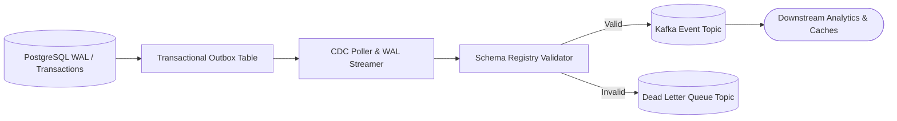

# ⚡ Event Stream CDC

[](https://github.com/txltedxgod/event-stream-cdc/actions/workflows/ci.yml)
[](https://www.python.org/)
[](https://opensource.org/licenses/MIT)
[](https://github.com/astral-sh/ruff)

High-throughput, real-time Change Data Capture (CDC) streaming engine implementing the Transactional Outbox pattern, progressive retry policies, and automated Dead Letter Queue (DLQ) error tracing.

---

## 🏛️ Architecture & Dataflow



```text
[ Database Mutation ]
         │
         ▼
[ Transactional Outbox (PENDING) ]
         │
         ├─── (flush_outbox) ───► [ Streaming Pipeline / Kafka Topic ]
         │
     (Failure?)
         ▼
[ DLQRouter ] ──(Attempt < Max)──► [ Progressive Retry Topic (.retry-1, .retry-2) ]
         │
  (Attempt >= Max)
         ▼
[ Terminal Dead Letter Queue (.DLQ) ] (Audit headers: attempt, error, epoch)
```

### Key Highlights
- **Transactional Outbox Pattern**: Decouples database mutations from asynchronous stream publication, preventing data loss on broker network partitions.
- **Progressive Retry Routing**: Failed events graduate through intermediate retry topics (`orders.retry-1`, `orders.retry-2`) before terminal quarantine.
- **Dead Letter Queue (DLQ)**: Terminal failure topic with comprehensive metadata headers (`x-retry-attempt`, `x-error-message`, `x-timestamp`, `x-terminal-dlq`).
- **REST Gateway**: FastAPI microservice for mutation capture and event stream inspection.

---

## 🚀 Quick Start

### Python SDK

```python
from cdc import CDCEngine, DLQRouter

# Initialize engine with custom DLQ router
router = DLQRouter(dlq_suffix=".DLQ", max_retries=3)
engine = CDCEngine(dlq_router=router)

# 1. Capture database mutation
evt_id = engine.capture_mutation("users", "INSERT", {"id": 101, "name": "Alice"})

# 2. Flush outbox to stream
flushed = engine.flush_outbox()
print(f"Flushed {flushed} events to stream.")

# 3. Handle processing failure
decision = engine.route_failure("cdc.users", evt_id, attempt=1, error_msg="Timeout")
print(decision.target_topic)    # "cdc.users.retry-1"
print(decision.is_terminal_dlq) # False

# 4. Final attempt routes to terminal DLQ
final_decision = engine.route_failure("cdc.users", evt_id, attempt=3, error_msg="Corrupted payload")
print(final_decision.target_topic)    # "cdc.users.DLQ"
print(final_decision.is_terminal_dlq) # True
```

---

## 📡 REST API Usage

Start the API service:
```bash
uvicorn cdc.api:app --port 8000
```

Capture mutation:
```bash
curl -X POST "http://localhost:8000/api/v1/capture" \
  -H "Content-Type: application/json" \
  -d '{"table": "orders", "operation": "CREATE", "data": {"amount": 250.00}}'
```

Inspect stream:
```bash
curl -X GET "http://localhost:8000/api/v1/stream"
```

---

## 🧪 Testing

```bash
pytest -v tests/
```

## 📄 License
MIT License
